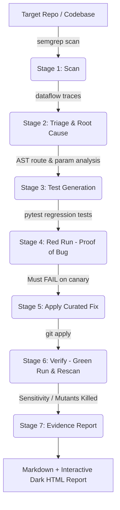

# 🛡️ PatchProof: Security Rules That Generate Regression Tests

> **A scanner tells you something looks wrong. PatchProof proves it is wrong, proves the fix works, and makes sure it never comes back.**

[](https://github.com/akshitsrijan001/patchproof/actions)
[](https://opensource.org/licenses/MIT)
[](https://www.python.org/downloads/)
[](https://semgrep.dev/)

---

## 1. The Idea in One Paragraph

Static analysis scanners like Semgrep flag potential vulnerabilities, but developers are left guessing whether findings are real, writing ad-hoc fixes, and hoping the bugs never return. **PatchProof closes the loop automatically**:
1. Traces the root cause from source to sink with clickable file and line links.
2. Generates an exploit-style pytest regression test seeded with secret canary oracles.
3. Runs the test on the vulnerable code and proves exploitability with a **FAIL (Red Run)**.
4. Applies a verified security fix.
5. Re-runs the test and shows it **PASS (Green Run)**.
6. Re-scans with Semgrep to confirm the finding is gone (Scanner Diff).
7. Validates test sensitivity against near-miss weak fix mutants (Bad-Fix Bypass Demo).
8. Generates comprehensive tamper-evident Markdown and interactive HTML evidence reports.

**Red then green, backed by a scanner diff.** That is the whole product.

---

## 2. System Architecture

```
          +-----------+     +-----------+     +--------------+
 repo --> | 1. SCAN   | --> | 2. TRIAGE | --> | 3. GENERATE  |
          | semgrep   |     | root cause|     | pytest tests |
          +-----------+     +-----------+     +--------------+
                                                     |
          +-----------+     +-----------+     +--------------+
          | 7. REPORT | <-- | 6. VERIFY | <-- | 4. RED RUN   |
          | html + md |     | rescan +  |     | must FAIL    |
          +-----------+     | green run |     +--------------+
                ^           +-----------+            |
                |                 ^            +--------------+
                |                 +----------- | 5. FIX       |
                |                              | patch + apply|
                +--- evidence store (JSON) --- +--------------+
```



---

## 3. The 7-Stage Pipeline

| Stage | Command | Action | Output / Gate |
|---|---|---|---|
| **1. Scan** | `patchproof scan` | Runs custom Semgrep taint mode rules | `before.json`, `before.sarif` |
| **2. Triage** | *Automatic* | Extracts source-to-sink dataflow & AST entrypoints | Normalized `Finding` records |
| **3. Generate** | `patchproof gen` | Renders bypass-resistant pytest tests with canary oracles | `generated_tests/test_*.py` |
| **4. Red Run** | `patchproof red` | Executes test against vulnerable application | Must **FAIL** (Proof of exploitability) |
| **5. Fix** | `patchproof fix` | Applies clean, verified patch | Unified diff applied to code |
| **6. Verify** | `patchproof verify` | Runs test (**PASS**), rescans with Semgrep, tests mutants | Green test + clean rescan + mutant score |
| **7. Report** | `patchproof report` | Compiles Markdown and HTML reports | `reports/report-*.md`, `report.html` |

---

## 4. Demo Vulnerabilities

All demo vulnerabilities are bundled in `target/vuln_app`:

1. **SQL Injection (CWE-89)**:
   - Route: `/search?q=`
   - Canary: `PP_CANARY_SQLI_8f2a` in secret table row
   - Exploit: `' OR '1'='1' --`
   - Fix: Parameterized queries (`cursor.execute(..., (?,))`)

2. **OS Command Injection (CWE-78)**:
   - Route: `/ping?host=`
   - Canary: `PP_CANARY_CMDI` execution
   - Exploit: `127.0.0.1; echo PP_CANARY_CMDI` or `$(echo PP_CANARY_CMDI)`
   - Fix: Argument list with `shell=False` and strict regex host validation

3. **Path Traversal (CWE-22)**:
   - Route: `/download?file=`
   - Canary: `PP_CANARY_PATHTRAVERSAL_3d7b` in `secrets/secret.txt`
   - Exploit: `../../secrets/secret.txt`
   - Fix: `werkzeug.utils.safe_join` + `os.path.realpath` boundary check

4. **Stretch: SSRF (CWE-918)**:
   - Route: `/fetch?url=`
   - Rule: Outbound requests to user-controlled URLs

---

## 5. The Bad-Fix Demo & Sensitivity Testing

A weak fix (like a naive blacklist) will fail against bypass payloads. PatchProof includes **near-miss mutation testing**:
- For Command Injection, `fixes/bad-fix-cmdi.patch` only strips `;` and `&&`.
- PatchProof's generated test fires the bypass payload `$(echo PP_CANARY_CMDI)`.
- The test **still FAILS**, and PatchProof rejects the fix with:
  > **❌ Fix Rejected: Bypass found!**

Each rule includes near-miss mutants in `fixes/mutants/` to compute a **Sensitivity Score** (e.g. `3/3 mutants killed`).

---

## 6. Repository Layout

```
patchproof/
├── ARCHITECTURE.md           # Full technical specifications
├── README.md                 # Project documentation
├── pyproject.toml            # Project packaging & CLI entrypoint
├── Dockerfile                # Isolated container runner (Linux/Semgrep)
├── .github/workflows/
│   └── patchproof.yml        # CI Action with PR summary bot
├── patchproof/               # Core Python package
│   ├── cli.py                # Typer CLI: scan, gen, red, fix, verify, report, demo
│   ├── models.py             # Data models (Finding, TraceStep, Evidence)
│   ├── scan.py               # Semgrep execution & JSON/SARIF parsing
│   ├── triage.py             # Dataflow trace parsing & root cause chain
│   ├── entrypoint.py         # AST route, method & parameter detection
│   ├── generate.py           # Jinja2 template rendering
│   ├── runner.py             # Pytest execution & red/green verification
│   ├── fix.py                # Git patch application & reversion
│   ├── verify.py             # Semgrep rescan diff & regression checks
│   ├── mutate.py             # Sensitivity testing against near-miss mutants
│   └── report.py             # Markdown and dark-theme HTML report builder
├── rules/                    # Custom Semgrep taint rules & rule tests
│   ├── sqli.yml / sqli.py
│   ├── cmdi.yml / cmdi.py
│   ├── pathtraversal.yml / pathtraversal.py
│   └── ssrf.yml
├── templates/                # Jinja2 regression test & HTML templates
│   ├── test_sqli.py.j2
│   ├── test_cmdi.py.j2
│   ├── test_pathtraversal.py.j2
│   └── report.html.j2
├── payloads/                 # Payloads & bypasses per CWE
│   └── payloads.yml
├── target/vuln_app/          # Deliberately vulnerable Flask app
│   ├── app.py
│   ├── public/readme.txt
│   └── secrets/secret.txt
├── fixes/                    # Curated patches, bad fix, and mutants
│   ├── 01-sqli.patch
│   ├── 02-cmdi.patch
│   ├── 03-pathtraversal.patch
│   ├── bad-fix-cmdi.patch
│   └── mutants/
├── generated_tests/          # Committed regression tests
├── reports/                  # Generated evidence reports
└── tests/                    # Unit tests for PatchProof itself
```

---

## 7. Quickstart & Usage

### One-Command Demo
```bash
# Run the complete end-to-end story in under 2 minutes:
patchproof demo
```

### Step-by-Step Execution
```bash
# 1. Scan target application
patchproof scan --target target/vuln_app

# 2. Generate regression tests
patchproof gen

# 3. Red Run (Prove exploitability)
patchproof red

# 4. Apply fix
patchproof fix

# 5. Green Run & Rescan Verification
patchproof verify

# 6. Generate Reports
patchproof report
```

### Running with Docker
```bash
# Build the container
docker build -t patchproof .

# Run the demo
docker run --rm patchproof
```

---

## 8. Continuous Integration & Bug Reintroduction Prevention

PatchProof includes a ready-to-use GitHub Action (`.github/workflows/patchproof.yml`).
When a Pull Request introduces code:
1. CI executes Semgrep with PatchProof rules.
2. If a vulnerability is found, tests are generated and confirmed via Red Run.
3. If fixed, the regression test is automatically committed.
4. **Reintroduction Prevention:** If a future PR inadvertently re-introduces the vulnerable code, the committed test suite turns CI 🔴 **RED**, identifying the exact regression test and vulnerability.

---

## 9. License

MIT License. Copyright (c) 2026 Akshit Srijan.

